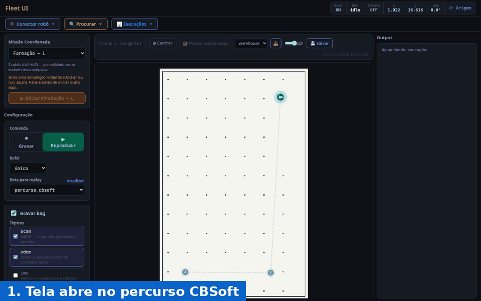

# Fleet UI · teste BLE no CIn-UFPE

Fleet UI configurado para o teste de conectividade Bluetooth Low Energy com o
TurtleBot4 no CIn-UFPE: o percurso em "L" (64 m em linha reta e mais 31 m)
roda numa simulação aberta ou no robô real, a partir de uma página web, e os
scripts de análise de RSSI já estão integrados.

Experimento original: "Wireless Connectivity Testing with Mobile Robots: A
Bluetooth Low Energy Case Study", CBSoft 2026.



*Demonstração real a partir de um clone limpo deste repositório: abrir, conectar e executar o percurso na simulação (6,6 min, acelerado).*

## Comece por aqui

| Documento | Para quê |
|---|---|
| [`docs/ufpe/Manual_FleetUI_teste_BLE.pdf`](docs/ufpe/Manual_FleetUI_teste_BLE.pdf) | Instalação e uso: simulação, análise e robô real |
| [`docs/ufpe/Roteiro_teste_CIn.pdf`](docs/ufpe/Roteiro_teste_CIn.pdf) | Passo a passo do dia do teste, em checklist |

## Instalação (Ubuntu 22.04 ou mais novo)

Só é preciso o Docker Engine oficial com o plugin `docker compose` e cerca de
15 GB livres. Não é preciso instalar ROS no computador: tudo roda num
contêiner com Ubuntu 24.04 e ROS 2 Jazzy. O passo 1 do manual tem os comandos
de instalação do Docker.

```bash
git clone https://github.com/eduardowanderleyde/fleet-ui-ufpe.git ~/fleet-ui
cd ~/fleet-ui
make docker-build      # só na primeira vez: 15 a 30 min
```

## Simulação

```bash
make cbsoft-up         # abre em http://localhost:5173
```

A tela já abre em **Reproduzir** com o percurso `percurso_cbsoft`. Clique em
**Conectar robô → Conectar** e depois em **▶ Executar replay** (cerca de
6,5 minutos). A simulação usa o domínio ROS 42, para nunca conversar com um
TurtleBot4 real na mesma rede.

O script original de navegação também roda na simulação, num segundo
terminal: `make cbsoft-run`.

## Análise de RSSI

```bash
make cbsoft-csv        # gravação mais recente → CSV no formato do nav_3points.py
make cbsoft-analise NAV=collections/cbsoft/<navegacao>.csv NRF="collections/cbsoft/nrf/<log>.txt"
```

## Robô real

O robô (ROS 2 Humble) e o Fleet UI (ROS 2 Jazzy) se conectam pelo Wi-Fi,
no domínio 0 e com CycloneDDS. As actions do Nav2 mudaram entre as duas
versões, então o Nav2 roda no PC, do lado do Fleet UI; o robô só envia laser,
odometria e TF e recebe velocidade, mensagens idênticas nas duas versões.

```bash
make robot-check       # checagem só de leitura: não publica nada
make robot-up          # mapa hall_cin_v4 + AMCL no START + Nav2, sem simulação
```

Antes do `robot-up`, desliguem qualquer outro Nav2 no mesmo domínio. Até
agora, o modo robô real foi testado com um robô falso
(`fleet_ws/scripts/fake_turtlebot4.py`); o roteiro tem o passo a passo do
primeiro teste com o robô de verdade.

## Testes

```bash
# backend e scripts (dentro da imagem)
docker compose run --rm --no-deps -w /workspace backend python3 -m pytest -q tests

# frontend
npm --prefix frontend ci
npm --prefix frontend test            # unidade
npm --prefix frontend run test:e2e    # ponta a ponta, com a API simulada
```

## Mais detalhes

O README técnico completo do Fleet UI (arquitetura, instalação sem Docker,
fluxo de experimentos) está em [`README_fleet-ui.md`](README_fleet-ui.md).
Os PDFs do manual e do roteiro são gerados a partir de `docs/ufpe/*.html` com
`npm --prefix frontend run docs:pdf`.
